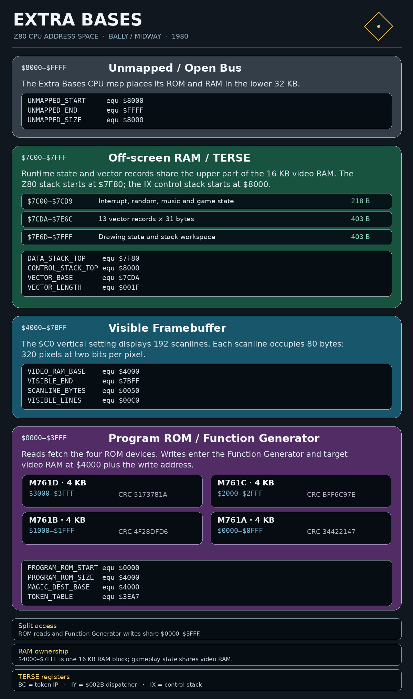

# Extra Bases

This project contains the Z80 disassembly and TERSE source developed by Dave Nutting Associates (DNA) and released by Bally/Midway in 1980. Extra Bases runs on the DNA Astrocade arcade hardware. 


| | |
| --- | --- |
| [TERSE execution](#terse-execution-architecture) | 95 thread entries and 2,319 tokens are decoded, with inline cells, branches, and counted strings separated from native instructions. |
| [Graphics and text](#graphics-and-text) | 48 named pattern assets, 36 large-font glyphs, and six small-text bitmaps have defined boundaries and pixel rows. |
| [Sound](#music-processor) | Eight music streams are matched to the TERSE score definitions and retained as command data. |
| [RAM and I/O](#ram-and-io) | The framebuffer, off-screen workspace, 31-byte vector records, interpreter registers, cabinet inputs, and trackball ports are mapped. |
| [Source reference](src/terse/README.md) | The block-by-block TERSE annotation includes an alphabetical word dictionary and comment-style bitmap grids. |


## Project layout

`src/eb_disassembly.asm`  
Z80 source, decoded TERSE streams, and data tables

`src/extra_bases.inc`  
ROM and RAM equates included by the disassembly

`src/terse/extra-bases-11-20-79.terse`  
TERSE source blocks

`src/terse/README.md`  
TERSE annotations and word dictionary

`build.sh`  
Linux assembly, ROM verification, and packaging

`build.bat`  
Windows assembly, ROM verification, and packaging

`roms/original/ebases.zip`  
Original ROM archive

`docs/`  
Operating manuals, hardware reference, and coding guidelines

`images/`  
Marquee and CPU memory map

## Build

Use **zmac 1.3**. Linux packaging also uses Python 3. The assembler accepts the source's original syntax and generates the complete `$0000–$3FFF` image.

Linux:

```sh
ZMAC=/path/to/zmac-1.3 ./build.sh
```

With zmac 1.3 on `PATH`:

```sh
./build.sh
```

Windows 10/11:

```bat
set ZMAC=C:\path\to\zmac.exe
build.bat
```

## ROM organization

Four 4 KB devices form one contiguous 16 KB Z80 image.

| ROM | Address | CRC32 | SHA1 |
| --- | --- | --- | --- |
| `m761a` | `$0000–$0FFF` | `34422147` | `6483ca1359b675b0dd739605db2a1dbd4b7fb8cb` |
| `m761b` | `$1000–$1FFF` | `4f28dfd6` | `52e571e671fa61b0f9ab397a5947094c24f6c388` |
| `m761c` | `$2000–$2FFF` | `bff6c97e` | `e41fb9db919039c8a48b4caebf80821a066d7ccf` |
| `m761d` | `$3000–$3FFF` | `5173781a` | `e60c3f4b075f8b811ff6a8637c4aa0b089847a82` |

Combined 16 KB image SHA1:
`9159c7770da7b693f9c5131453513545d3683831`



## TERSE execution architecture

Extra Bases uses byte-token TERSE. `_NEXT` at `$002B` reads one token through `BC`, advances the instruction pointer, doubles the token index, and fetches a native execution address from `TOKEN_TABLE` at `$3EA7`. The table holds 172 little-endian address cells, covering token values `$00–$AB`.

A high-level word begins with `RST $08`. `_ENTER` saves the caller's `BC` on the IX control stack and loads the inline thread address from the native stack. `_RETURN` at `$003A` restores the saved `BC`. Native primitives continue through `JP (IY)`.

| Register/address | Ownership |
| --- | --- |
| `BC` | TERSE token instruction pointer |
| `SP=$7F80` | Initial parameter-stack pointer; native calls and pushes share this stack |
| `IX=$8000` | Initial downward-growing TERSE return/control stack |
| `IY=$002B` | Interpreter dispatch continuation |
| `RST $08` | Nested TERSE thread entry |
| `$3EA7–$3FFE` | 172-entry token dispatch table |

Inline operands are explicit data: token `$19` carries a byte, `$1B` carries a cell, `$1E/$1F` carry branch destinations, and `$2E` carries a counted string. Array and inline-base operations carry their base-address cells. The disassembly expresses these boundaries with `DB` and `DW` and identifies each token's destination.

Forty complete definitions are linked to their TERSE source blocks. These include `BONE`, `BZERO`, `WHBODDS`, runner-occupancy checks, event strings, continuation prompts, `INNODDS`, `RETPA`, and `SETTFPA`. The [ROM map](docs/extra_bases_rom_map.md) lists their addresses and source blocks.

## Graphics and text

Patterns use four-byte headers containing X/Y hotspots, row width, and row count. The source separates each header from its bitmap rows and retains the TERSE pattern names: `TUP`, `RUP`, `FUP`, standing figures, bat angles, bases, ball, markers, and dugout.

The large font starts at `$02D1`. Its ten-byte records contain space, digits 0–9, and letters A–Y. `cpost` at `$0E31` selects the glyph, writes its ten rows, and advances the text position.

Six pre-rendered five-row text patterns occupy `$0439–$04AB`:

| Pattern | Address | Size in bytes × rows |
| --- | --- | --- |
| CREDITS | `$0439–$044C` | `4 × 5` |
| ISITOR | `$044D–$045B` | `3 × 5` |
| OME | `$045C–$0465` | `2 × 5` |
| Inning digits 1–9 | `$0466–$0492` | `9 × 5` |
| UP | `$0493–$0497` | `1 × 5` |
| YOU ARE | `$0498–$04AB` | `4 × 5` |

`HOM` and `VIS` combine a large initial letter with the OME and ISITOR patterns. `SUP` draws UP. Field drawing uses the CREDITS and inning-digit patterns, and the player-start sequence draws YOU ARE. Pixel rows appear directly beside the corresponding `DB` statements. Every large-font glyph has ten individual row previews. Small-text previews separate character cells with spaces and preserve all padding bits; `#` is a set bit and `.` is a clear bit. The Linux build checks every preview against its emitted bytes.

## Vector animation and playactions

`verase` occupies `$0EF9–$0F1F` and returns before the playaction tables at `$0F20`. It erases the vector's saved image using the stored pattern and screen address.

The 497 bytes at `$0F20–$1110` contain 64 seven-byte action records and 49 one-byte commands. An action sets magic, animation selection, update count, and signed fixed-point Y/X increments. Commands select movement handlers, record base fielders, start throws, deactivate vectors, and select the standing action.

`OPTBL` at `$278F` dispatches commands `$02–$0E`. `OPCODECHK`, `LOADANM`, `ANMSEQLOAD`, and `PACTLOAD` decode the records and populate each vector. The animation pointer tables at `$088D–$0958` connect the 11-entry `PATTERNS` matrix to perspective tables, animation sequences, and bitmap assets. The [playaction reference](docs/extra_bases_playactions.md) lists the tables and command targets.

## Music processor

The native music processor reads command streams through the pointer at `$7C1C`. Commands set sound registers, load note durations, and transfer to other stream addresses. Native helpers advance the stream pointer and maintain its repeat/start/timer state.

The disassembly bounds and names `BALLSCORE`, `COINSCORE`, `FOULSCORE`, `CRACKSCORE`, `FENCESCORE`, `TAKE_ME`, `SAFESCORE`, and `OUTSCORE` using the TERSE score definitions. The [ROM map](docs/extra_bases_rom_map.md#music-streams) records each range.

## RAM and I/O

The CPU has 16 KB of shared RAM at `$4000–$7FFF`. A visible setting of `$C0` scanlines uses `$4000–$7BFF` for the 320 × 192 framebuffer. Runtime state, vector records, drawing workspace, and both stacks occupy the upper RAM area.

Thirteen 31-byte vector records occupy `$7CDA–$7E6C`: four runners, pitcher, four infielders, three outfielders, and ball. Their fields hold animation state, playaction pointers, fixed-point positions and velocities, status bits, destinations, and saved drawing addresses.

The foreground sentry at `$3E4E` polls the pending game flags and calls button, pitch, outfield, throw, contact, catch, and score handlers. Its TERSE callback at `$3E11` services higher-level requests.

Cabinet and DIP inputs use the sound/I/O read ports. Port `$13` returns the selected trackball delta; writing `$28` selects its axis/station. Port `$20` drives coin-counter outputs. The [memory and I/O reference](docs/extra_bases_memory_map.md) records the address ranges and bit assignments.

## References

- [Extra Bases hardware reference](docs/extra_bases_hardware_reference.md)
- [Parts and Operating Manual, July 1980](docs/Extra_Bases_Parts_and_Operating_Manual_(July_1980).pdf)
- [General Instructions](docs/Extra_Bases_General_Instructions_(M051-00761-A010).pdf)
- [TERSE naming guidelines](docs/TERSE_Naming_Guidelines.md)
- [Z80 coding style](docs/Z80_Coding_Style_Guidelines.md)
- [MAME Astrocade driver](https://github.com/mamedev/mame/blob/master/src/mame/bally/astrocde.cpp)
- [zmac 1.3 Windows distribution](https://ballyalley.com/ml/ml_tools/Zmac13_win32.zip)
